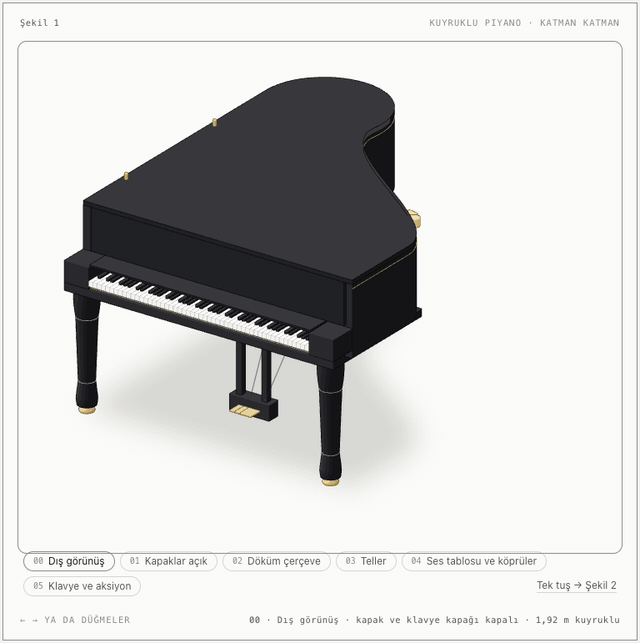
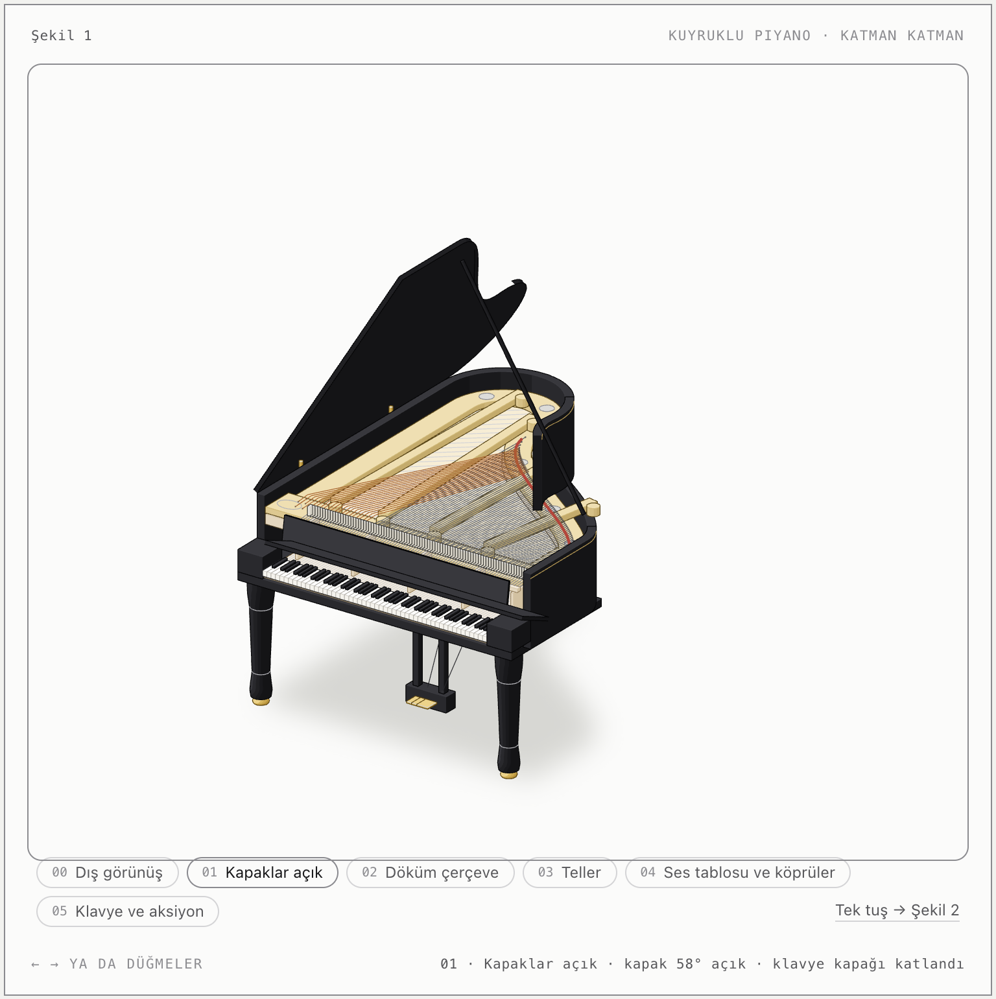
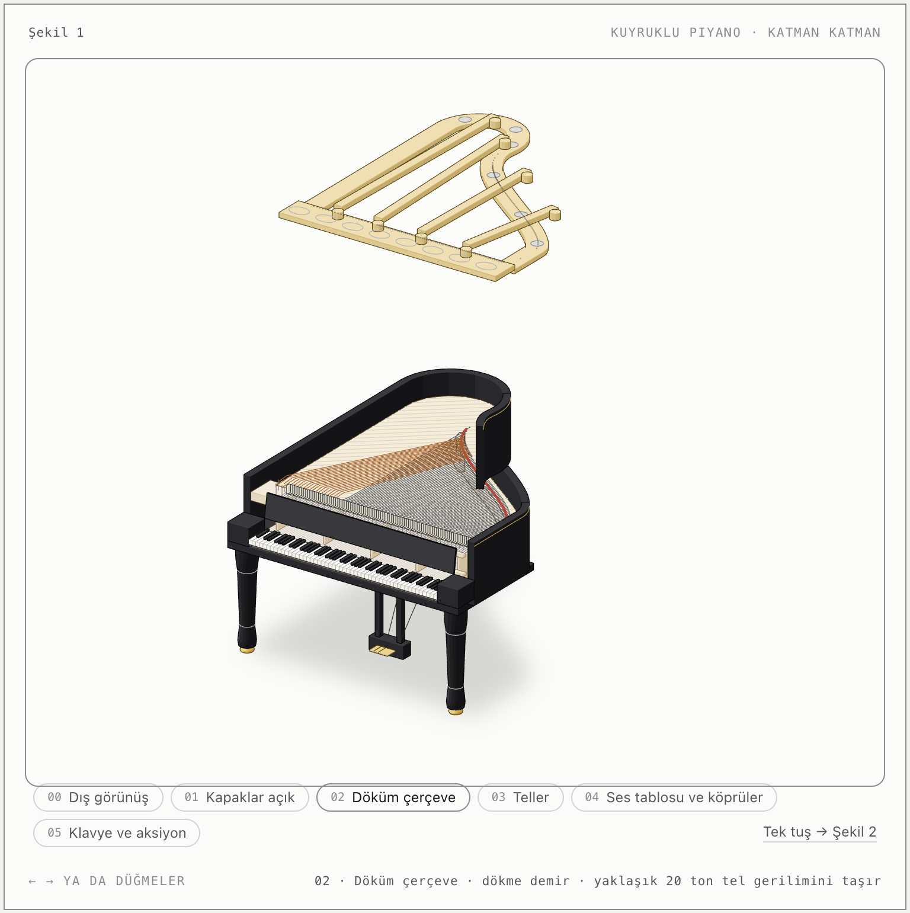
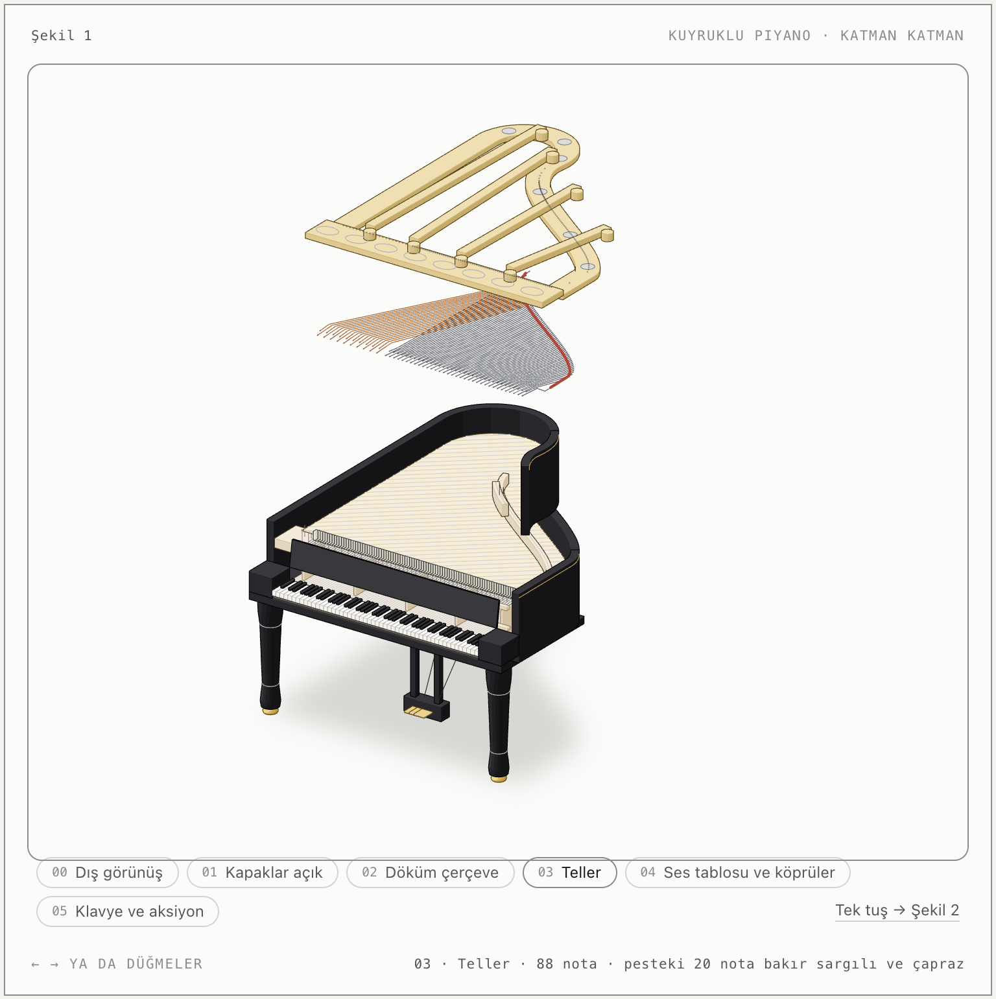
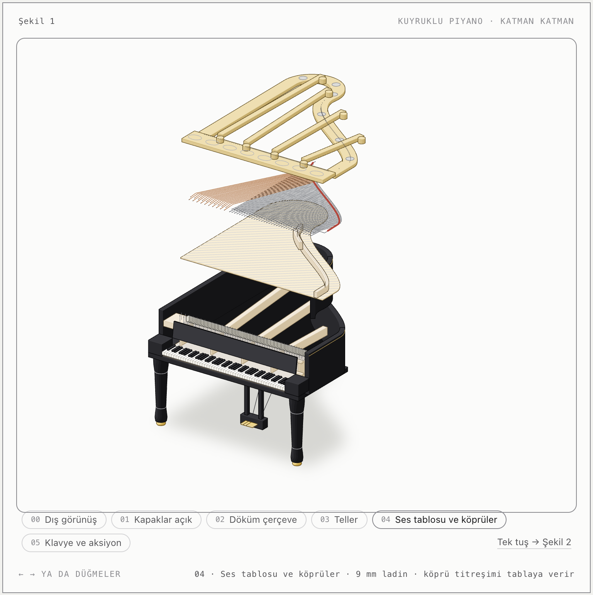
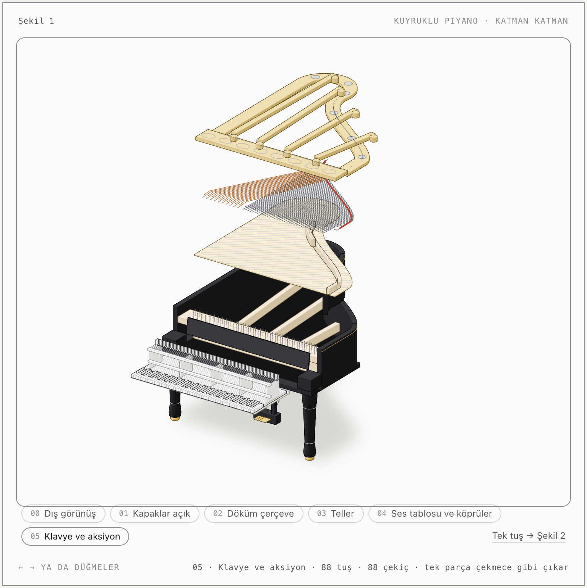
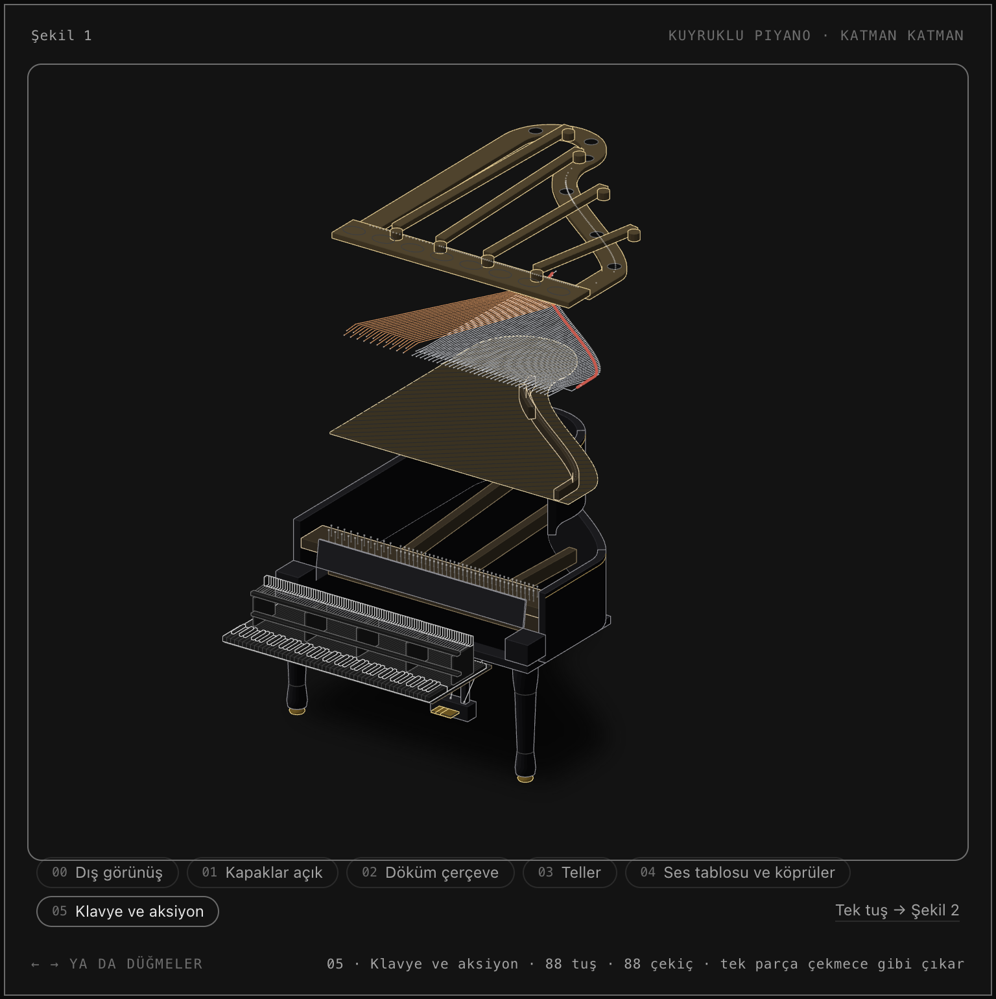
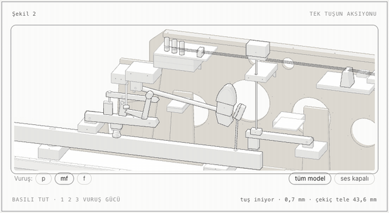
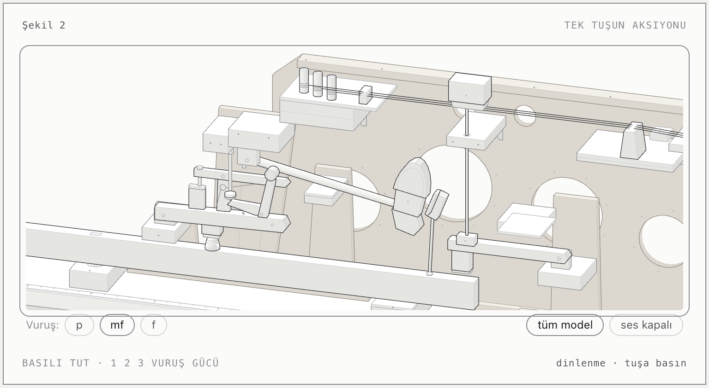
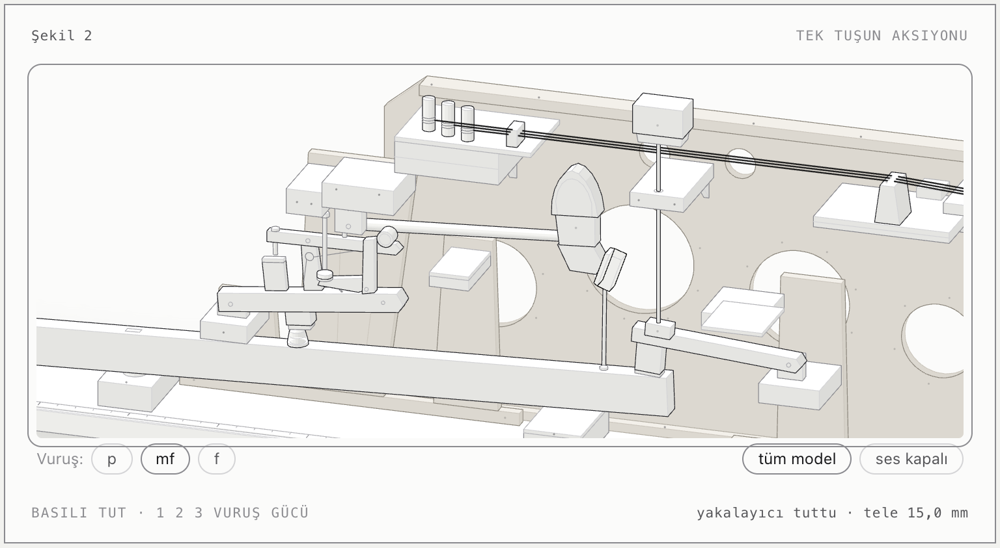

# Kuyruklu Piyano · Katman Katman

Bir kuyruklu piyanoyu dışarıdan kapalı halde gösteren, sonra kapağını açıp katmanlarına ayıran ve tek bir tuşun mekanizmasını ağır çekimde çalıştıran etkileşimli bir izometrik çizim. Tek bir HTML dosyasıdır: internet bağlantısı, kütüphane ya da sunucu gerektirmez.

<p align="center">
  
</p>

## İçindekiler

- [Hızlı başlangıç](#hızlı-başlangıç)
- [Şekil 1 – Katman katman piyano](#şekil-1--katman-katman-piyano)
- [Şekil 2 – Tek tuşun aksiyonu](#şekil-2--tek-tuşun-aksiyonu)
- [Gerçeğe dayalı değerler](#gerçeğe-dayalı-değerler)
- [Proje yapısı](#proje-yapısı)
- [Yeniden derleme](#yeniden-derleme)
- [Sınırlar](#sınırlar)

## Hızlı başlangıç

`piyano-aksiyonu.html` dosyasını tarayıcıda açın. Sayfa sistemin açık ya da koyu temasına uyar. Her zaman koyu tema için `piyano-aksiyonu-koyu.html` dosyasını kullanın.

| Nerede | Ne yapılır |
|---|---|
| Şekil 1 | Alttaki adım düğmeleri ya da **← →** tuşları katmanları açar. **Home / End** ilk ve son adıma gider. |
| Şekil 2 | Çizime **basılı tutun** ya da **boşluk** tuşunu basılı tutun; bırakınca tuş geri döner. **1 2 3** tuşları vuruş gücünü p / mf / f yapar. |
| Şekil 2 | **yakın plan / tüm model** görünümü değiştirir. **ses** düğmesi C6 notasını açar. |

Dokunulmazsa iki şekil de kendi kendine bir gösteri döngüsü oynatır. İşletim sisteminde "hareketi azalt" açıksa döngü çalışmaz, parçalar doğrudan son konumlarına geçer.

## Şekil 1 – Katman katman piyano

1,92 m'lik bir kuyruklu piyano, milimetre ölçüsüyle çizildi. Kasa, ayaklar ve pedal lirı yerinde kalır. Katmanlar yukarı kalkar, klavye ve aksiyon da bir çekmece gibi öne çıkar. Kamera her adımda o an görünen parçaları çerçeveler.

| | |
|:---:|:---:|
| <br>**00 · Dış görünüş**<br>Siyah lake kasa, tornalı ayaklar, pirinç tekerlekler, pedal lirı | <br>**01 · Kapaklar açık**<br>Kapak 58° açık, klavye kapağı katlanmış, nota sehpası geride |
| <br>**02 · Döküm çerçeve**<br>Yaklaşık 20 tonluk tel gerilimini taşıyan altın renkli dökme demir | <br>**03 · Teller**<br>88 nota; pesteki 20 nota bakır sargılı ve çapraz geçiyor |
| <br>**04 · Ses tablosu ve köprüler**<br>9 mm ladin tabla; altında kasa destekleri ve pim bloğu | <br>**05 · Klavye ve aksiyon**<br>88 tuş ve 88 çekiç tek parça halinde öne çıkıyor |

Malzemeler hafif renklerle ayrılır: lake siyah kasa, altın renkli döküm çerçeve, ladin ses tablosu, akçaağaç köprü, pim bloğu ve aksiyon, fildişi tuşlar, bakır pes telleri ve kırmızı keçe şerit.

<p align="center">
  <br>
  <sub>Koyu tema</sub>
</p>

## Şekil 2 – Tek tuşun aksiyonu

Şekil 1'deki klavyeden tek bir tuş: çift kaçışlı (double escapement) bir kuyruklu aksiyonun yandan kesiti, C6 notası (1046,5 Hz). Hareket 25 kat yavaş akar. Jakın kaçışından çekicin tele vuruşuna kadar geçen yaklaşık 1 ms'lik an 220 kata kadar yavaşlatılır. Alt satırda o anki faz ve gerçek zaman (ms) yazar.

<p align="center">
  
</p>

| Dinlenme | Tele vuruş | Yakalayıcı tuttu |
|:---:|:---:|:---:|
|  |  |  |

O an işi yapan parça koyu kenarla vurgulanır. Fazlar şu sırayla ilerler:

1. **Tuş iniyor:** Tuş denge pimi üzerinde döner. Kapstan vipeni, vipen de jakı kaldırır; jak çekici iter.
2. **Jak kaçış düğmesinde:** Jakın ayağı düğmeye değer ve jak yavaşça yatmaya başlar.
3. **Kaçış:** Jak çekiç topuzunun altından kayar. Çekiç tele 2 mm kala serbest kalır ve yoluna kendi hızıyla devam eder.
4. **Tele vuruş ve geri sekme:** Çekiç teli titreşen uzunluğun 1/8'inden vurur ve geri seker.
5. **Yakalayıcı tuttu:** Tuş basılı kaldıkça yakalayıcı çekici telin 15 mm altında tutar.
6. **Tekrar kolu:** Tuş yarıya döndüğünde tekrar kolu yayıyla çekici havada tutar. Jak topuzun altına geri oturur ve tuşu tamamen bırakmadan ikinci vuruş yapılabilir: çift kaçış budur.
7. **Susturucu:** Tuş bırakılınca susturucu keçesi tele iner ve sesi keser.

Çok yavaş basıldığında çekiç tele ulaşamadan geri düşer; gerçek piyanoda da böyle olur.

## Gerçeğe dayalı değerler

Şekil 2'deki hareket bir kinematik modelden (`model.mjs`) ve onun üzerindeki fizik benzetiminden (`sim.mjs`) gelir. Kaçış düğmesi, düşüş vidası, yakalayıcı ve susturucunun konumları, bir piyano teknisyeninin kullandığı regülasyon değerlerinden hesaplanır.

| Ölçü | Değer |
|---|---|
| Tuş inişi | 10 mm |
| Jakın düğmeye değmesi | 4,4 mm'de |
| Kaçış | 8,8 mm'de (çekiç tele 2 mm kala) |
| Düşüş | 2 mm |
| Yakalama | telin 15 mm altında |
| Vuruş mesafesi | 48 mm |
| Aksiyon oranı | yaklaşık 5,2 |
| Susturucunun kalkması | 5 mm'de |
| Vuruş noktası | titreşen uzunluğun 1/8'i (211 mm'lik telde 26,4 mm) |
| Çekiç hızı | p 0,8 m/s · mf 1,9 m/s · f 4,2 m/s |

Şekil 1'deki bilgiler genel kuyruklu piyano değerleridir: yaklaşık 230 tel, toplamda 20 tona yaklaşan tel gerilimi, 9 mm'lik ladin ses tablosu, 88 tuş ve 88 çekiç.

## Proje yapısı

```
anatomy-piano/
├── piyano-aksiyonu.html        derlenmiş sayfa (sistem temasına uyar)
├── piyano-aksiyonu-koyu.html   derlenmiş sayfa (her zaman koyu)
├── build.mjs                   sayfayı derler: iki şekli, stilleri ve canlı kodu birleştirir
├── fig-piano.mjs               Şekil 1: adımlar, katman hareketleri, kamera çerçeveleri, malzeme renkleri
├── piano.mjs                   piyano geometrisi: kasa, kapak, çerçeve, teller, ses tablosu, klavye, ayaklar
├── piano-live.js               Şekil 1'in tarayıcıdaki hareketi ve çizim sırası
├── model.mjs                   tek tuşun kinematiği ve regülasyon hesapları
├── sim.mjs                     tuş, jak, tekrar kolu, çekiç, yakalayıcı ve susturucu benzetimi
├── parts.mjs                   Şekil 2'nin parçaları
├── live.js                     Şekil 2'nin tarayıcıdaki hareketi, ses ve etkileşim
└── gorseller/                  bu dosyadaki ekran görüntüleri ve animasyonlar
```

## Yeniden derleme

Kodu değiştirdikten sonra sayfayı yeniden üretin:

```sh
node build.mjs          # piyano-aksiyonu.html
node build.mjs --dark   # piyano-aksiyonu-koyu.html
```

Gerekenler:

- Node.js 18 ya da üstü.
- Claude Code'un **anatomy** yeteneğindeki çizim kiti. Yolu `build.mjs` içindeki `SKILL` sabitinde yazar (`~/.claude/skills/anatomy`). Kit başka bir yerdeyse bu satırı güncelleyin.

Derlenen HTML dosyası kiti kendi içine gömer; açmak için kit gerekmez.

## Sınırlar

- **Katmanların yönü:** Şekil 1'deki katmanlar okunabilirlik için tam dikey değil, hafif çapraz (yukarı ve kuyruğa doğru) ayrılır.
- **Kapak:** Döküm çerçeve kalkarken kapak soluklaşıp kaybolur, çünkü açık kapak kalkan katmanlarla aynı yere düşer.
- **Susturucular:** Şekil 1'de çizilmedi; tek tuşun susturucusu Şekil 2'de var.
- **Tekrar kolu:** Şekil 2'de jakın arkasına, yana kaydırılmış çizildi. Gerçekte jak, kolun ortasındaki bir pencereden geçer.
- **Çizim sırası:** Parçaların üst üste binme sırası elle ayarlandı ve ana pozlarda ekran görüntüsüyle kontrol edildi. Kitin otomatik derinlik denetimi bu çizimde çalıştırılmadı.
- **Ses:** Basit bir sentezdir, gerçek bir piyano kaydı değildir.
